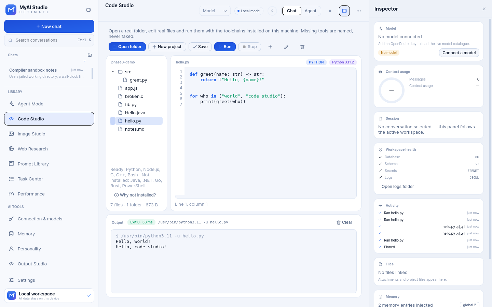

# MyAI Studio Ultimate

A premium, local-first AI desktop workspace for Windows 11: multi-model chat, memory,
a real code studio, supervised agents, media and research — delivered in five verified
phases.

> **Current build: Phase 3 — Code Studio** (`v0.3.0`)
> Chat streams from OpenRouter, memory and personality are real and editable, the Output
> Studio keeps every revision, and Code Studio now opens real folders, edits real files
> and runs them with the toolchains actually installed on the machine. Agent Mode, web,
> image and GitHub remain clearly labelled as later phases — they are **not** simulated.




---

## 1. What exists today (verified)

| Area | State | Evidence |
| --- | --- | --- |
| PySide6 desktop application, launch → shutdown | **Works** | `python -m myai --smoke`, `tests/ui/test_main_window.py` |
| CLI overrides (`--lang`, `--theme`) and single-instance lock | **Works** | `tests/ui/test_cli.py` (real subprocesses) |
| Design-token theme system, 3 themes + 5 accents, light/dark | **Works** | `tests/unit/test_tokens_theme.py`, screenshots 01–05 |
| Persian RTL + English LTR, instant switching | **Works** | `tests/ui/test_main_window.py::test_language_switch_*` |
| SQLite persistence, WAL, schema versioning, migrations hook | **Works** | `tests/unit/test_database_repositories.py` |
| Conversations: create, rename, pin, folder, delete, export Markdown | **Works** | `tests/ui/test_main_window.py`, `tests/unit/test_conversation_service.py` |
| Settings registry with validation + live application | **Works** | `tests/unit/test_settings_secrets.py` |
| Encrypted secret store (DPAPI on Windows, Fernet elsewhere) | **Works** | `tests/unit/test_settings_secrets.py` |
| Structured JSON logging + in-app activity feed | **Works** | `myai/core/logging.py`, logs under the workspace folder |
| Local backups excluding secrets | **Works** | `tests/unit/test_conversation_service.py::test_backup_*` |
| Local chat history storage (messages persist per conversation) | **Works** | UI + DB tests |
| OpenRouter key management (enter / replace / delete, encrypted at rest) | **Works** | `tests/ui/test_phase2_pages.py`, `tests/unit/test_settings_secrets.py` |
| Connection test + live model catalogue with capabilities from provider data | **Works** (logic); **not live-tested** — `openrouter.ai` blocked here | `tests/unit/test_openrouter.py` (`httpx.MockTransport`) |
| Streaming replies, cancel, first-token and total latency, token usage | **Works** | `tests/unit/test_chat_service.py`, `tests/ui/test_phase2_pages.py::test_streaming_round_trip_through_the_window` |
| Typed API errors (auth, credit, rate limit, timeout, network) in fa/en | **Works** | `tests/unit/test_openrouter.py`, UI error tests |
| Model chooser in the header, default model persisted | **Works** | UI tests |
| Global + per-conversation memory, CRUD, summaries with user consent | **Works** | `tests/unit/test_memory.py`, UI tests |
| User profile file + assistant persona, separate from memory | **Works** | `tests/unit/test_persona_outputs.py`, `tests/ui/test_phase2_pages.py` |
| Output Studio: code/text/prompt/Markdown/JSON, revisions, diff, restore, export | **Works** | `tests/unit/test_persona_outputs.py`, UI tests |
| Code Studio: open a real folder, browse/edit files, `Ctrl+S`, autosave, recent projects | **Works** | `tests/ui/test_code_studio.py`, `p3_code_*.png` |
| Real execution with the toolchain detected on this machine | **Works** | python 3.11.2 / node 22 / gcc / g++ / bash here; `tests/unit/test_code_services.py` |
| Real stdout, stderr, exit code and duration in the output panel | **Works** | `06_code_studio_run_en.png`, `p3_code_dawn_en.png` |
| Compiler errors shown verbatim, then fix and re-run | **Works** | `p3_code_compile_error_dawn_en.png` (gcc's own `broken.c:5:5: error: …`) |
| Missing toolchains named with the exact executable | **Works** | `p3_code_unavailable_midnight_fa.png` (`javac and java not found on PATH`) |
| Stop a running program, wall-clock limit, no GUI blocking | **Works** | `test_stop_kills_a_long_run`, `test_run_does_not_block_the_ui` |
| Agent Mode, web research, Image Studio, GitHub, task centre | **Not in this build** — Phases 4–5 | — |

The complete, honest matrix lives in [`docs/PHASE3_REPORT.md`](docs/PHASE3_REPORT.md) §2
(Phase 1: [`docs/PHASE1_REPORT.md`](docs/PHASE1_REPORT.md), Phase 2:
[`docs/PHASE2_REPORT.md`](docs/PHASE2_REPORT.md)).

---

## 2. Requirements

- **Windows 11** (x64) for the shipped product.
- **Python 3.10 – 3.13** for running from source (developed and tested on 3.11).
- No external service is required to launch the app, keep memory and profile files,
  or use the Output Studio — that part is fully local. **Real chat replies need an
  OpenRouter key** (Connection & models page) plus outbound HTTPS to `openrouter.ai`;
  without them the app says so instead of faking an answer.
- Runtime dependencies: PySide6 6.8, SQLAlchemy 2.0, httpx 0.28, cryptography,
  keyring. Install with `pip install -r requirements.txt` (tests add pytest, pytest-qt,
  ruff and pyinstaller from `requirements-dev.txt`).

## 3. Run from source

```powershell
cd myai_studio
.\run_windows.bat              # provisions .venv on first run, then starts the app
```

or step by step:

```powershell
python -m venv .venv
.venv\Scripts\activate
pip install -r requirements.txt

python -m myai                 # Persian UI (default), dark theme
python -m myai --lang en       # English UI
python -m myai --theme dawn    # light theme for this run
```

On Linux/macOS the same commands work; secrets use a local Fernet key file there
instead of Windows DPAPI.

### Command-line switches

| Switch | Purpose |
| --- | --- |
| `--home <dir>` | Use a different data directory (portable/testing) |
| `--lang fa\|en` | Force the interface language for this run |
| `--theme midnight\|dawn\|aurora\|system` | Force a theme for this run |
| `--smoke` | Start the UI and exit automatically (CI health check) |
| `--screenshot <file>` | Render the window to a PNG and exit |
| `--allow-multi` | Skip the single-instance lock |

## 4. Build the Windows executable

```powershell
powershell -ExecutionPolicy Bypass -File scripts\build_windows.ps1
powershell -ExecutionPolicy Bypass -File scripts\build_windows.ps1 -Installer   # also build setup.exe
```

The script installs build requirements, runs the whole test suite, packages with
PyInstaller, **smoke-tests the packaged executable**, and only then reports success.
Output: `dist\MyAIStudio\MyAIStudio.exe` (and `dist\installer\MyAIStudio-<version>-setup.exe`
with `-Installer`, requiring Inno Setup 6).

> An `.exe` is produced only when this script actually succeeds on a Windows machine.
> The repository never ships a placeholder binary.

## 5. Run the tests

```bash
# Windows
.venv\Scripts\python -m pytest -q

# Linux/macOS helper (headless Qt)
./scripts/run_tests.sh -q
```

Last measured run (final code, after the last change):

```
319 passed, 1 skipped in 122.23s (0:02:02)
```

Per layer: `tests/unit` 156 passed + 1 skipped (3.92 s), `tests/integration` 14 passed
(0.60 s), `tests/ui` 149 passed (113.85 s). The skip is the opt-in live OpenRouter test,
which needs a real key and network access this build host does not have. Details and
per-layer timings are in [`docs/PHASE3_REPORT.md`](docs/PHASE3_REPORT.md) §1.

Test layout:

```
tests/unit          providers (mocked transport), memory, persona, outputs, chat service,
                    toolchains/runner/projects (real python, gcc and node runs),
                    tokens, i18n, markdown, DB, settings, secrets, backups
tests/ui            real widgets: window, sidebar, composer, dialogs, themes, RTL,
                    API/memory/personality/studio pages, Code Studio (real files and
                    real processes), streaming bubbles
tests/integration   cross-layer flows, backup secret-exclusion, restart survival
```

## 6. Where your data lives

Default workspace: `%APPDATA%\MyAIStudio`

```
myai_studio.db      SQLite database (WAL)
logs/               JSONL structured logs (rotated)
secrets.bin         encrypted API keys (DPAPI / Fernet)
secret.key          local Fernet key (non-Windows only, mode 0600)
backups/            zip snapshots: database + non-sensitive settings
outputs/            generated images, documents, videos
projects/           workspace projects
```

Override with `--home` or the `MYAI_STUDIO_HOME` environment variable.
API keys are never written to logs, exports or backups.

## 7. Project structure

```
myai/
  app.py              QApplication bootstrap, single-instance lock, CLI
  context.py          composition root (paths → db → repositories → services)
  core/               paths, events, logging, errors, markdown, time utils
  data/               SQLAlchemy models, database lifecycle, repositories
  services/           settings, conversations, activity, backups, openrouter, chat,
                      memory, persona, outputs, toolchains, runner, projects
  security/           encrypted secret store
  i18n/               translation runtime + fa/en catalogues
  ui/
    theme/            design tokens, theme manager, icon system
    widgets/          buttons, fields, feedback, dialogs, markdown, painting guard
    views/            sidebar, header, composer, chat, inspector, settings, placeholders,
                      api_page, memory_page, persona_page, output_page, code_page
    main_window.py    application shell
    brand.py          vector identity
tests/                unit, ui, integration
scripts/              capture_ui.py, run_tests.sh, build_windows.ps1
packaging/            PyInstaller launcher + Inno Setup script
docs/                 architecture, phase reports, user guide (fa)
artifacts/ui/         screenshots produced by scripts/capture_ui.py
```

## 8. Design language

- Deep navy/charcoal surfaces, layered greys, electric blue accent, soft violet complement.
- Controlled glass effects, 12–18 px radii, 1 px borders, soft depth — no heavy blur.
- Every colour, radius, font size and animation duration comes from **design tokens**
  (`myai/ui/theme/tokens.py`); the Qt stylesheet is generated from them at runtime.
- Custom-painted controls (navigation, toggles, send button, meters) for states that
  stylesheets cannot express; all of them are keyboard focusable with visible rings.
- Icon set is a single coherent vector family drawn in `myai/ui/theme/icons.py`.

## 9. Documentation

- [`docs/ARCHITECTURE.md`](docs/ARCHITECTURE.md) — layers, threading model, extension points
- [`docs/PHASE1_REPORT.md`](docs/PHASE1_REPORT.md) — foundation report
- [`docs/PHASE2_REPORT.md`](docs/PHASE2_REPORT.md) — AI core report, API setup, real results
- [`docs/PHASE2_REPORT_FA.md`](docs/PHASE2_REPORT_FA.md) — گزارش فارسی فاز ۲
- [`docs/PHASE3_REPORT.md`](docs/PHASE3_REPORT.md) — Code Studio report, real-execution evidence, limits
- [`docs/PHASE3_REPORT_FA.md`](docs/PHASE3_REPORT_FA.md) — گزارش فارسی فاز ۳
- [`docs/INSTALL_FA.md`](docs/INSTALL_FA.md) — راهنمای نصب و اجرا (فارسی)
- [`docs/TESTING.md`](docs/TESTING.md) — how to run and extend the tests
- [`docs/ROADMAP.md`](docs/ROADMAP.md) — the five phases and their acceptance criteria

## 10. Licence and third-party notices

Source: MIT (see `LICENSE` in this folder).
Bundled fonts: **Inter** (SIL OFL 1.1) and **Vazirmatn** (SIL OFL 1.1) — licence texts
in `assets/fonts/`. Qt for Python/PySide6 is used under the LGPLv3.
