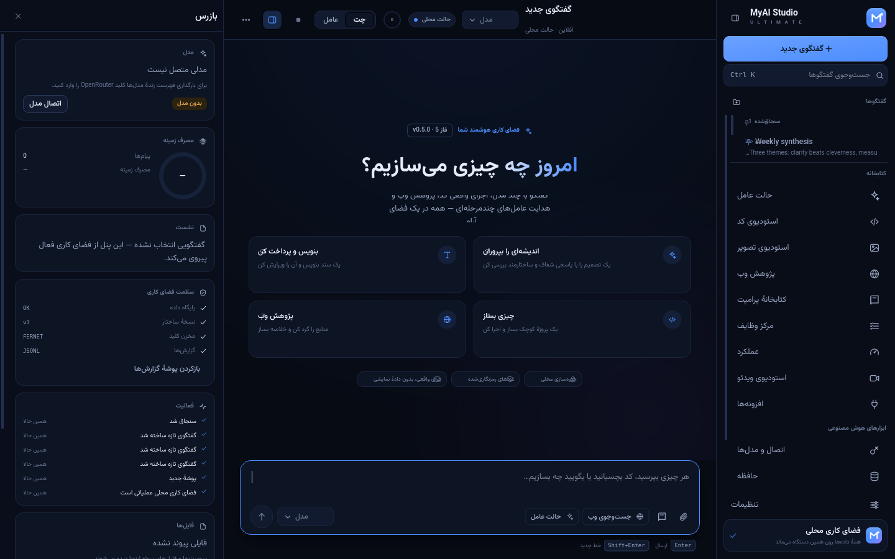
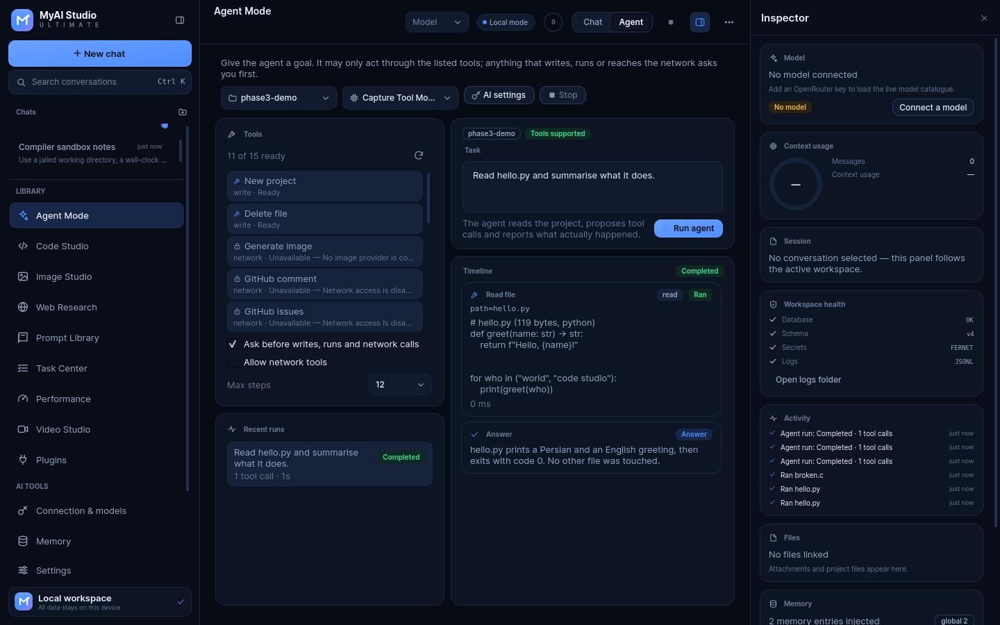
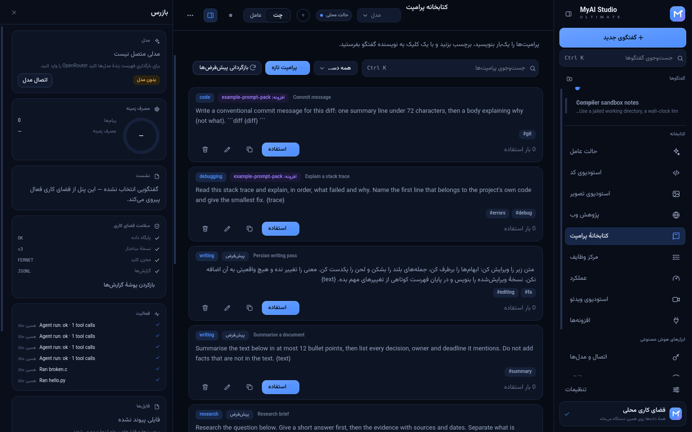
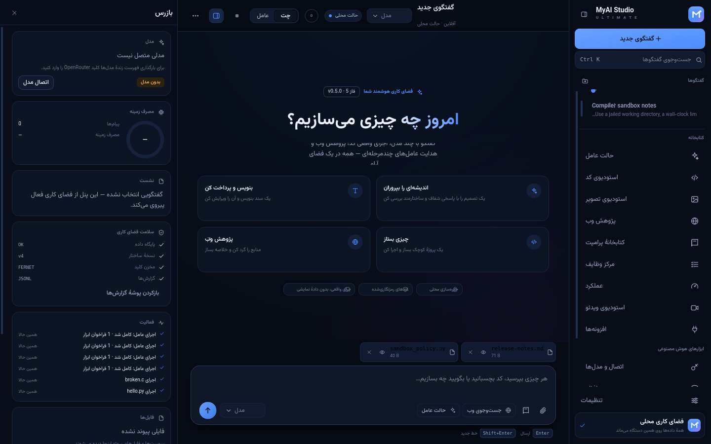
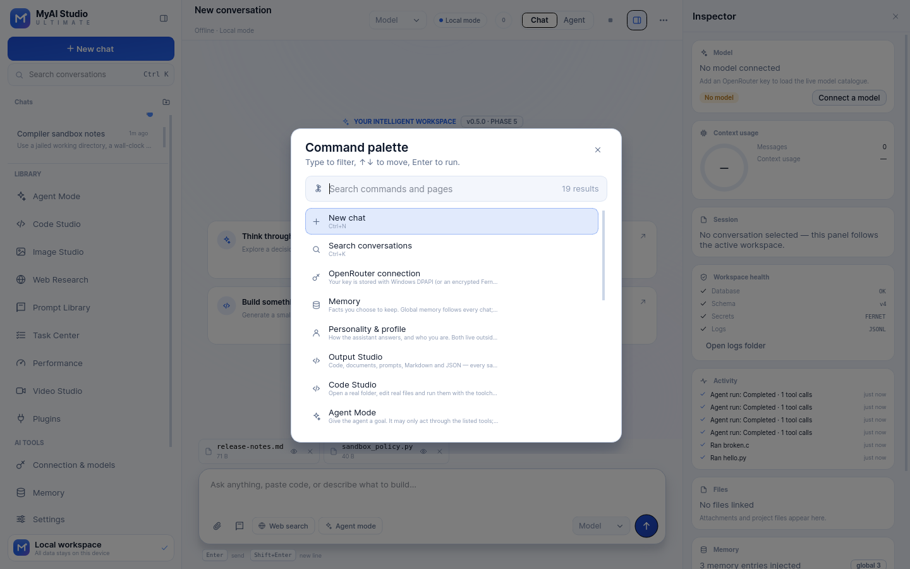

# MyAI Studio Ultimate

A premium, local-first AI desktop workspace for Windows 11: multi-model chat, memory,
a real code studio, supervised agents, media and research — delivered in five verified
phases.

> **Current build: `0.7.3` — Phase 5 + LAB + Round 3, with a Windows x64 release**
> (`v0.7.3`; the phase notes below describe the shipped feature set)
> Chat streams from OpenRouter, memory and personality are real and editable, the Output
> Studio keeps every revision, Code Studio opens real folders and runs real files, and the
> agent acts **only** through twenty-two registered tools behind an approval gate. Phase 5
> added the prompt library, the task centre (every finished agent and program run is
> persisted), a performance monitor sampled from the real process, plugin loading for
> prompt packs, and full keyboard/screen-reader labelling. Image Studio, Video Studio and
> web **search** are present and clearly marked **unavailable** — no provider exists — while
> their libraries and direct page reading are real.
>
> **After Phase 5 (current branch):** a second hardening round (seven more agent tools,
> a static Windows gate, API-key hygiene) and a final capability round that adds five
> LAB pages — **Review** (real diff + patch dry-run), **Project Atlas** (import graph),
> **Context Map** (what the next request really contains), **Appearance** (accent lab
> with a WCAG audit) and **Diagnostics** (14 measured checks). See
> [`docs/LAB_PAGES.md`](docs/LAB_PAGES.md) and its Persian counterpart.
>
> **Round 3 (this branch):** three everyday capabilities — **global search** over
> every local source (Ctrl+Shift+F), a **Usage & cost** dashboard built from the
> tokens the provider reported plus the cached per-million prices, and **file
> history** in Code Studio where every save/patch is a version and a restore is
> itself versioned. This branch also ships the first **Windows executable** (see [Download](#download-windows-x64)).
> See [`docs/ROUND3_CAPABILITIES.md`](docs/ROUND3_CAPABILITIES.md).

## Download (Windows x64)

[**MyAI Studio Ultimate 0.7.3 — Windows x64**](https://github.com/mohammadmirzazadeh335-wq/AISystemOptimizer/releases/download/v0.7.3/MyAIStudio-v0.7.3-windows-x64.zip) — about 59 MB.

Extract the zip and run `MyAIStudio.exe`; keep the `_internal` folder beside it.
Data lives in `%APPDATA%\MyAIStudio`; projects default to `Documents\MyAI Studio Projects`. The build is produced by
`.github/workflows/windows-build.yml` on GitHub's `windows-latest` runner, where the
packaged executable is smoke-started before the zip is published. It is **not
code-signed**, so Windows SmartScreen asks for confirmation on first launch.











---

## 1. What exists today (verified)

| Area | State | Evidence |
| --- | --- | --- |
| PySide6 desktop application, launch → shutdown | **Works** | `python -m myai --smoke`, `tests/ui/test_main_window.py` |
| CLI overrides (`--lang`, `--theme`) and single-instance lock | **Works** | `tests/ui/test_cli.py` (real subprocesses) |
| Design-token theme system, 3 themes + 5 accents, light/dark | **Works** | `tests/unit/test_tokens_theme.py`, screenshots 01–05 |
| Persian RTL + English LTR, instant switching | **Works** | `tests/ui/test_main_window.py::test_language_switch_*` |
| SQLite persistence, WAL, schema versioning, migrations hook | **Works** | `tests/unit/test_database_repositories.py` |
| Conversations: create, rename, pin, folder, delete, export Markdown | **Works** | `tests/ui/test_main_window.py`, `tests/unit/test_conversation_service.py` |
| Settings registry with validation + live application | **Works** | `tests/unit/test_settings_secrets.py` |
| Encrypted secret store (DPAPI on Windows, Fernet elsewhere) | **Works** | `tests/unit/test_settings_secrets.py` |
| Structured JSON logging + in-app activity feed | **Works** | `myai/core/logging.py`, logs under the workspace folder |
| Local backups excluding secrets | **Works** | `tests/unit/test_conversation_service.py::test_backup_*` |
| Local chat history storage (messages persist per conversation) | **Works** | UI + DB tests |
| OpenRouter key management (enter / replace / delete, encrypted at rest) | **Works** | `tests/ui/test_phase2_pages.py`, `tests/unit/test_settings_secrets.py` |
| Connection test + live model catalogue with capabilities from provider data | **Works** (logic); **not live-tested** — `openrouter.ai` blocked here | `tests/unit/test_openrouter.py` (`httpx.MockTransport`) |
| Streaming replies, cancel, first-token and total latency, token usage | **Works** | `tests/unit/test_chat_service.py`, `tests/ui/test_phase2_pages.py::test_streaming_round_trip_through_the_window` |
| Typed API errors (auth, credit, rate limit, timeout, network) in fa/en | **Works** | `tests/unit/test_openrouter.py`, UI error tests |
| Model chooser in the header, default model persisted | **Works** | UI tests |
| Global + per-conversation memory, CRUD, summaries with user consent | **Works** | `tests/unit/test_memory.py`, UI tests |
| User profile file + assistant persona, separate from memory | **Works** | `tests/unit/test_persona_outputs.py`, `tests/ui/test_phase2_pages.py` |
| Output Studio: code/text/prompt/Markdown/JSON, revisions, diff, restore, export | **Works** | `tests/unit/test_persona_outputs.py`, UI tests |
| Code Studio: open a real folder, browse/edit files, `Ctrl+S`, autosave, recent projects | **Works** | `tests/ui/test_code_studio.py`, `p3_code_*.png` |
| Agent Mode: 22 registered tools with JSON schemas and risk levels | **Works** | `myai/services/tools.py`, `tests/unit/test_agent_tools.py` |
| Approval gate: writes, runs and network calls ask first; a denial never executes | **Works** | `tests/unit/test_agent.py`, `tests/ui/test_agent_page.py` |
| Unavailable tools name the exact missing piece (key, folder, network, endpoint, token, image provider) | **Works** | `agent.reason_*` in fa/en, tool rows, Settings → Agent |
| Bounded loop with step limit, cancel and per-step results fed back verbatim | **Works** | `tests/unit/test_agent.py` |
| Agent runs real `python` files through the Phase-3 toolchain detection | **Works** | `tests/unit/test_agent_tools.py::test_run_file_*` |
| Web search and GitHub tools | **Works when configured** (SearxNG endpoint / GitHub token); otherwise reported unavailable | `tests/unit/test_openrouter_tools.py`, mocked `MockTransport` HTTP |
| Image generation | **Not available** — no provider exists, and the tool says so | `tests/unit/test_agent_tools.py::test_generate_image_is_unavailable` |
| Real execution with the toolchain detected on this machine | **Works** | python 3.11.2 / node 22 / gcc / g++ / bash here; `tests/unit/test_code_services.py` |
| Real stdout, stderr, exit code and duration in the output panel | **Works** | `06_code_studio_run_en.png`, `p3_code_dawn_en.png` |
| Compiler errors shown verbatim, then fix and re-run | **Works** | `p3_code_compile_error_dawn_en.png` (gcc's own `broken.c:5:5: error: …`) |
| Missing toolchains named with the exact executable | **Works** | `p3_code_unavailable_midnight_fa.png` (`javac and java not found on PATH`) |
| Stop a running program, wall-clock limit, no GUI blocking | **Works** | `test_stop_kills_a_long_run`, `test_run_does_not_block_the_ui` |
| Prompt library: SQLite store, six built-ins, CRUD, search, categories, tags, use counter, send to composer | **Works** | `tests/unit/test_phase5_services.py`, `tests/ui/test_phase5_pages.py`, `p5_prompts_*.png` |
| Task centre: every finished agent and program run persisted with status, model, project, tools, duration, steps | **Works** | `tests/unit/test_phase5_services.py::test_a_finished_agent_run_becomes_a_real_task_row`, `p5_tasks_*.png` |
| Performance monitor: process CPU/RAM/threads, system RAM, disk, workspace/database/log sizes, 2 s auto-refresh | **Works** | `tests/unit/test_phase5_services.py::test_performance_*`, `p5_performance_*.png` |
| Image Studio and Video Studio | **Unavailable by design** — no provider; library of real files with preview/open/delete | `p5_images_*.png`, `p5_video_*.png`, `tests/ui/test_phase5_pages.py` |
| Web research: read a public page, extract text, copy, save as Markdown | **Works**; **search is unavailable** — no search provider, said on the page | `tests/unit/test_phase5_services.py::test_web_fetch_*`, `p5_web_*.png` |
| Plugins: `plugin.json` discovery, permissions, prompt packs disabled by default, edited copies survive disable | **Works**; code plugins are rejected, never executed | `tests/unit/test_phase5_services.py`, `p5_plugins_*.png` |
| Accessibility: named controls on every page, Tab/Shift-Tab containment, Escape closes modals | **Works** | `tests/ui/test_accessibility.py` (36 assertions) |
| File attachments: text/code/Office text extracted, copied under `<home>/attachments`, and **appended to the message the model receives** | **Works** | `tests/unit/test_attachments.py`, `tests/ui/test_attachments_ui.py`, `attach_chips_midnight_fa.png` |
| Attachments survive restart: chips re-appear from the `attachments` table (schema v4) and the stored copy can be re-read | **Works** | `tests/unit/test_attachments.py::test_rows_are_stored_per_message`, `tests/unit/test_database_repositories.py` |
| Honest gaps in attachments: images/PDFs are recorded by name, size and dimensions but no text (no OCR/PDF parser); the chip and preview say so | **Works** | `test_png_dimensions_are_read_from_the_header`, `test_pdf_is_recorded_without_fake_text` |
| Agent file tools: `search_files`, `make_folder`, `create_project` (write tools behind the approval gate) | **Works** | `tests/unit/test_file_tools.py`, `tests/ui/test_agent_page.py` |
| Command palette (`Ctrl+Shift+P`): 19 real actions, type-to-filter, ↑/↓ with a visible selection that does not depend on window focus | **Works** | `tests/ui/test_palette.py`, `palette_dawn_en.png` |
| Windows 11 portability: frozen-build interpreter, hidden-console flags, encoding-safe decoding, reserved-name/path rules, `cmd` toolchain for `.bat` | **Rules verified on Linux**; runtime needs one Windows run | `tests/unit/test_windows_platform.py` (37), `scripts/check_portability.py` (17/17), `scripts/windows11_smoke.ps1` |
| Agent exploration tools: `project_map`, `find_files`, `read_lines`, `scan_todos`, `diff_files` | **Works** | `tests/unit/test_agent_ideas.py` |
| Atomic patch editor: `apply_patch` applies real `@@` hunks, tolerates line drift, writes nothing if a hunk fails | **Works** | `tests/unit/test_patches.py`, `tests/unit/test_agent_ideas.py` |
| Agent page reader: `fetch_url` reads one public page through the Web Research reader (network gate) | **Works** | `tests/unit/test_agent_ideas.py` |
| Windows static gate: no POSIX import at import time, no unmasked child console, no locale-encoded text I/O, no unguarded POSIX API | **Verified here (17/17 portability checks)** | `scripts/check_windows_static.py`, `tests/unit/test_windows_static.py` (13) |
| API-key hygiene: shape check before any request (blocks header injection), encrypted store, redaction in every log handler, key absent from DB and backups | **Works** | `tests/unit/test_api_key_safety.py` (19) |
| Settings has no mock pages: the AI page writes a real temperature used on the next send, the Memory page shows the live row count and opens Memory | **Works** | `tests/ui/test_settings_dialog.py::test_temperature_slider_writes_the_real_setting`, `::test_memory_toggle_is_written_and_used` |
| **Review**: line diff of any two project files with real `+ / − / ~` counts, character-level intra-line highlights, swap, save-diff | **Works** | `tests/unit/test_review.py` (15), `tests/ui/test_lab_pages.py::test_review_*`, `p6_review_*.png` |
| **Review → Apply patch**: parses real `@@` hunks, dry-runs every hunk, refuses a patch whose context does not exist, writes only after confirmation | **Works** | `test_review_patch_preview_then_apply_writes_the_file`, `test_review_refuses_a_patch_that_does_not_apply` |
| **Project Atlas**: the import graph of the open folder — files, lines, resolved imports, unlinked files, hub ranking, deterministic layout | **Works** | `tests/unit/test_atlas_and_context.py` (16), `p6_atlas_*.png` |
| **Project Atlas → click a node**: switches to Code Studio with that file open | **Works** | `test_clicking_a_hub_opens_the_file_in_code_studio` |
| **Context Map**: the next request measured from the blocks the sender really builds — donut, 100 % segment bar, five largest contributors, advice | **Works** | `tests/unit/test_atlas_and_context.py`, `p6_context_*.png` |
| **Appearance**: six accents (custom = hue/saturation/brightness + hex), real-widget preview, WCAG 2.1 audit for seven pairs, apply/reset written to settings | **Works** | `tests/unit/test_colorlab.py` (29), `test_applying_an_accent_updates_the_theme`, `p6_appearance_*.png` |
| **Diagnostics**: 14 measured checks (database, schema, disk, backups, logs, attachments, secrets, key shape, Windows names, workspace, settings, locales, rows, toolchains) with a weighted score and clipboard report | **Works** | `tests/unit/test_doctor.py` (14), `test_doctor_runs_every_check_and_reports_a_score`, `p6_doctor_*.png` |
| **Sidebar LAB group**: five extra routes as 30 px two-column tiles; icon-only one-column rail when collapsed so nothing falls below the fold | **Works** | `test_collapsed_rail_keeps_every_lab_tile_visible_and_icon_only`, `lab_*_collapsed.png` |

The complete, honest matrix lives in [`docs/PHASE4_REPORT.md`](docs/PHASE4_REPORT.md) §3
(Phase 3: [`docs/PHASE3_REPORT.md`](docs/PHASE3_REPORT.md) §2)
(Phase 1: [`docs/PHASE1_REPORT.md`](docs/PHASE1_REPORT.md), Phase 2:
[`docs/PHASE2_REPORT.md`](docs/PHASE2_REPORT.md)).

---

## 2. Requirements

- **Windows 11** (x64) for the shipped product.
- **Python 3.10 – 3.13** for running from source (developed and tested on 3.11).
- No external service is required to launch the app, keep memory and profile files,
  or use the Output Studio — that part is fully local. **Real chat replies need an
  OpenRouter key** (Connection & models page) plus outbound HTTPS to `openrouter.ai`;
  without them the app says so instead of faking an answer.
- Runtime dependencies: PySide6 6.8, SQLAlchemy 2.0, httpx 0.28, cryptography,
  keyring. Install with `pip install -r requirements.txt` (tests add pytest, pytest-qt,
  ruff and pyinstaller from `requirements-dev.txt`).

## 3. Run from source

```powershell
cd myai_studio
.\run_windows.bat              # provisions .venv on first run, then starts the app
```

or step by step:

```powershell
python -m venv .venv
.venv\Scripts\activate
pip install -r requirements.txt

python -m myai                 # Persian UI (default), dark theme
python -m myai --lang en       # English UI
python -m myai --theme dawn    # light theme for this run
```

On Linux/macOS the same commands work; secrets use a local Fernet key file there
instead of Windows DPAPI.

### Command-line switches

| Switch | Purpose |
| --- | --- |
| `--home <dir>` | Use a different data directory (portable/testing) |
| `--lang fa\|en` | Force the interface language for this run |
| `--theme midnight\|dawn\|aurora\|system` | Force a theme for this run |
| `--smoke` | Start the UI and exit automatically (CI health check) |
| `--screenshot <file>` | Render the window to a PNG and exit |
| `--allow-multi` | Skip the single-instance lock |

## 3.1 Verify it on Windows 11

This repository was developed and tested on Linux; it has **not** been executed
on a Windows machine yet. The Windows-specific rules are covered by tests, and
one command performs the real check on a Windows 11 box:

```powershell
powershell -ExecutionPolicy Bypass -File scripts\windows11_smoke.ps1
```

It checks the OS and Python, builds a throwaway venv, runs the portability
checks and the whole test suite, starts the real GUI with a temporary
workspace, and prints PASS/FAIL per step. `-SkipTests` skips the suite.
The portability script also runs the static source gate (`scripts/check_windows_static.py`):
POSIX-only imports at import time, missing `creationflags`, locale-encoded text I/O,
unguarded POSIX process calls, `sys.executable` as a child command and hard-coded
POSIX paths are all rejected with file and line.

Details, including the eight Windows defects that were fixed:
[`docs/POST_PHASE5_UPGRADE.md`](docs/POST_PHASE5_UPGRADE.md).

## 4. Build the Windows executable

```powershell
powershell -ExecutionPolicy Bypass -File scripts\build_windows.ps1
powershell -ExecutionPolicy Bypass -File scripts\build_windows.ps1 -Installer   # also build setup.exe
```

The script installs build requirements, runs the whole test suite, packages with
PyInstaller, **smoke-tests the packaged executable**, and only then reports success.
Output: `dist\MyAIStudio\MyAIStudio.exe` (and `dist\installer\MyAIStudio-<version>-setup.exe`
with `-Installer`, requiring Inno Setup 6).

> An `.exe` is produced only when this script actually succeeds on a Windows machine.
> The repository never ships a placeholder binary.

## 5. Run the tests

```bash
# Windows
.venv\Scripts\python -m pytest -q

# Linux/macOS helper (headless Qt)
./scripts/run_tests.sh -q
```

Last measured run (final code of the LAB round):

```
803 passed, 1 skipped in 509.58s (0:08:29)
```

The skip is the opt-in live OpenRouter test, which needs a real key and network
access this build host does not have. Per-layer numbers and the exact command
are in [`docs/POST_PHASE5_UPGRADE.md`](docs/POST_PHASE5_UPGRADE.md) §6 and §9.4; the
Phase 5 report keeps its own historical figures in
[`docs/PHASE5_REPORT.md`](docs/PHASE5_REPORT.md) §1.

Test layout:

```
tests/unit          providers (mocked transport), memory, persona, outputs, chat service,
                    toolchains/runner/projects (real python, gcc and node runs),
                    agent tools (real files, real runs, mocked HTTP), the agent loop,
                    tokens, i18n, markdown, DB, settings, secrets, backups
tests/ui            real widgets: window, sidebar, composer, dialogs, themes, RTL,
                    API/memory/personality/studio pages, Code Studio (real files and
                    real processes), Agent Mode (approval dialog, timeline, step limit),
                    streaming bubbles, the five LAB pages driven through the window
tests/integration   cross-layer flows, backup secret-exclusion, restart survival
```

## 6. Where your data lives

Default workspace: `%APPDATA%\MyAIStudio`

```
myai_studio.db      SQLite database (WAL)
logs/               JSONL structured logs (rotated)
secrets.bin         encrypted API keys (DPAPI / Fernet)
secret.key          local Fernet key (non-Windows only, mode 0600)
backups/            zip snapshots: database + non-sensitive settings
outputs/            generated images, documents, videos
projects/           workspace projects
```

Override with `--home` or the `MYAI_STUDIO_HOME` environment variable.
API keys are never written to logs, exports or backups.

## 7. Project structure

```
myai/
  app.py              QApplication bootstrap, single-instance lock, CLI
  context.py          composition root (paths → db → repositories → services)
  core/               paths, events, logging, errors, markdown, time utils
  data/               SQLAlchemy models, database lifecycle, repositories
  services/           settings, conversations, activity, backups, openrouter, chat,
                      memory, persona, outputs, toolchains, runner, projects,
                      tools (registry + handlers), agent (bounded loop),
                      review (diff + patch), atlas (import graph), doctor (health)
  security/           encrypted secret store
  i18n/               translation runtime + fa/en catalogues
  ui/
    theme/            design tokens, theme manager, icon system
    widgets/          buttons, fields, feedback, dialogs, markdown, painting guard
    views/            sidebar, header, composer, chat, inspector, settings, placeholders,
                      api_page, memory_page, persona_page, output_page, code_page,
                      agent_page, review_page, atlas_page, context_page,
                      appearance_page, doctor_page
    main_window.py    application shell
    brand.py          vector identity
tests/                unit, ui, integration
scripts/              capture_ui.py, run_tests.sh, build_windows.ps1
packaging/            PyInstaller launcher + Inno Setup script
docs/                 architecture, phase reports, user guide (fa)
artifacts/ui/         screenshots produced by scripts/capture_ui.py
```

## 8. Design language

- Deep navy/charcoal surfaces, layered greys, electric blue accent, soft violet complement.
- Controlled glass effects, 12–18 px radii, 1 px borders, soft depth — no heavy blur.
- Every colour, radius, font size and animation duration comes from **design tokens**
  (`myai/ui/theme/tokens.py`); the Qt stylesheet is generated from them at runtime.
- Custom-painted controls (navigation, toggles, send button, meters) for states that
  stylesheets cannot express; all of them are keyboard focusable with visible rings.
- Icon set is a single coherent vector family drawn in `myai/ui/theme/icons.py`.

## 9. Documentation

- [`docs/ARCHITECTURE.md`](docs/ARCHITECTURE.md) — layers, threading model, extension points
- [`docs/PHASE1_REPORT.md`](docs/PHASE1_REPORT.md) — foundation report
- [`docs/PHASE2_REPORT.md`](docs/PHASE2_REPORT.md) — AI core report, API setup, real results
- [`docs/PHASE2_REPORT_FA.md`](docs/PHASE2_REPORT_FA.md) — گزارش فارسی فاز ۲
- [`docs/PHASE3_REPORT.md`](docs/PHASE3_REPORT.md) — Code Studio report, real-execution evidence, limits
- [`docs/PHASE3_REPORT_FA.md`](docs/PHASE3_REPORT_FA.md) — گزارش فارسی فاز ۳
- [`docs/PHASE4_REPORT.md`](docs/PHASE4_REPORT.md) — Agent Mode report: tools, approvals, test numbers, limits
- [`docs/PHASE4_REPORT_FA.md`](docs/PHASE4_REPORT_FA.md) — گزارش فارسی فاز ۴
- [`docs/PHASE5_REPORT.md`](docs/PHASE5_REPORT.md) — Ecosystem report: prompt library, task centre, performance, plugins, a11y, limits
- [`docs/PHASE5_REPORT_FA.md`](docs/PHASE5_REPORT_FA.md) — گزارش فارسی فاز ۵
- [`docs/AGENT_MODE.md`](docs/AGENT_MODE.md) — Agent Mode guide: tools, approval, network setup
- [`docs/AGENT_MODE_FA.md`](docs/AGENT_MODE_FA.md) — راهنمای حالت عامل (فارسی)
- [`docs/INSTALL_FA.md`](docs/INSTALL_FA.md) — راهنمای نصب و اجرا (فارسی)
- [`docs/LAB_PAGES.md`](docs/LAB_PAGES.md) — the five LAB capabilities: Review, Project Atlas, Context Map, Appearance, Diagnostics
- [`docs/LAB_PAGES_FA.md`](docs/LAB_PAGES_FA.md) — راهنمای فارسی صفحه‌های LAB
- [`docs/ROUND3_CAPABILITIES.md`](docs/ROUND3_CAPABILITIES.md) — global search, usage & cost, file history
- [`docs/FINAL_DEBUG_REPORT.md`](docs/FINAL_DEBUG_REPORT.md) — the final debug pass and the Windows build ([فارسی](docs/FINAL_DEBUG_REPORT_FA.md))
- [`docs/ROUND3_CAPABILITIES_FA.md`](docs/ROUND3_CAPABILITIES_FA.md) — جست‌وجوی سراسری، مصرف و هزینه، تاریخچه‌ی فایل (فارسی)
- [`docs/TESTING.md`](docs/TESTING.md) — how to run and extend the tests
- [`docs/ROADMAP.md`](docs/ROADMAP.md) — the five phases and their acceptance criteria

## 10. Licence and third-party notices

Source: MIT (see `LICENSE` in this folder).
Bundled fonts: **Inter** (SIL OFL 1.1) and **Vazirmatn** (SIL OFL 1.1) — licence texts
in `assets/fonts/`. Qt for Python/PySide6 is used under the LGPLv3.
